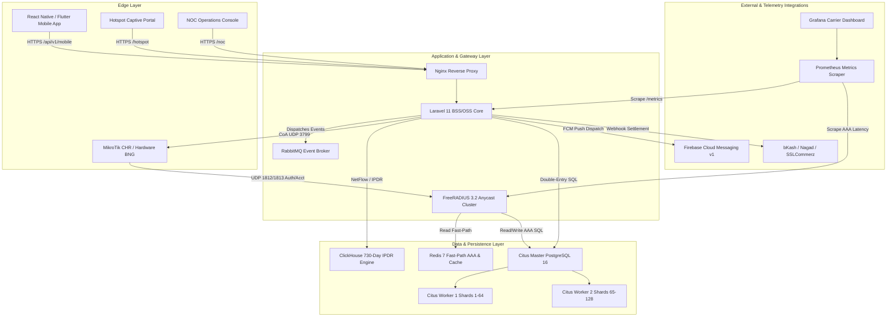

# Component Dependency & Subsystem Map

**Architecture Version:** 2.2.0  
**Scope:** Carrier BSS/OSS Subsystem Interdependencies

---

## 1. Subsystem Interaction Matrix

---

## 2. Dependency Breakdown by Service

| Service | Upstream Dependencies | Downstream Consumers | Failure Mode & Fallback |
| :--- | :--- | :--- | :--- |
| **Laravel BSS/OSS** | Citus Master, Redis Cluster, RabbitMQ | Mobile Clients, Admin Users, Webhooks | 503 Maintenance Page; Async retry queues |
| **FreeRADIUS AAA** | Redis Cluster, Citus Master | MikroTik BNG, Wi-Fi APs | Local Redis fallback; fail-open or walled garden |
| **Citus Master** | Citus Workers 1 & 2 | Laravel BSS, FreeRADIUS | Automated PostgreSQL failover standby |
| **ClickHouse** | RabbitMQ / IPDR Ingest | BTRC Cyber Forensic Audits | Local buffer spooling if ClickHouse offline |
| **Mobile Push Service** | FCM v1 HTTP API | Subscriber Devices | Mock sandbox mode; Citus notification log |
