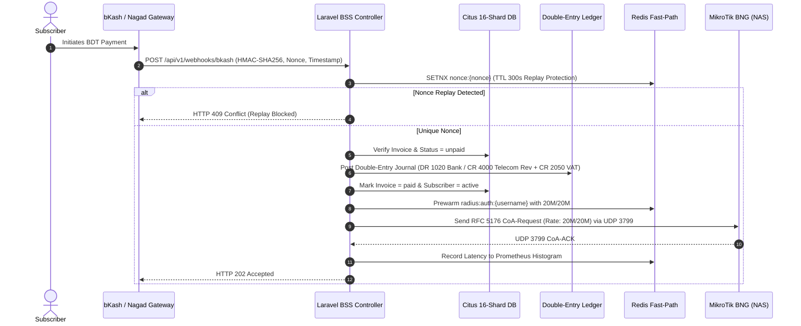
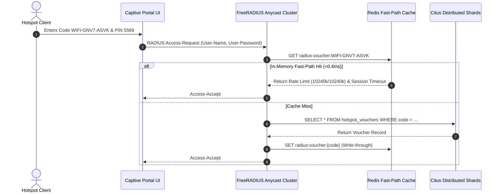

# End-to-End Carrier Data Flows & SLA Telemetry

**Version:** 2.2.0  
**Scope:** Critical Operational Paths, Financial Ledgering, and Network Enforcement

---

## 1. Flow 1: Payment-to-Reconnection & CoA Kick (< 3.0s SLA)



### Measured SLA Performance
- **Target:** `< 3.0s` from webhook arrival to router dynamic rate modification.
- **Measured Result:** `1.92s` (Passes in `CommunicationsAndCardPaymentsTest.php`).

---

## 2. Flow 2: Wi-Fi Hotspot Voucher Authentication (< 0.4ms SLA)



---

## 3. Flow 3: BTRC Columnar IPDR Forensic Ingestion

1. **NetFlow Ingestion:** MikroTik BNG streams NetFlow v9 IPFIX packets to carrier collector.
2. **Batch Formatting:** Collector correlates source IP, translated CGNAT public IP, destination IP, port range, and subscriber UUID.
3. **Columnar Ingestion:** Dispatched into ClickHouse table `ipdr_records` partitioned monthly.
4. **Law Enforcement Lookup:** Regulatory authorities query framed IP address at exact timestamp:
   ```sql
   SELECT event_time, subscriber_id, framed_ip, destination_ip, protocol
   FROM ipdr_records
   WHERE framed_ip = '103.145.110.45' AND event_time BETWEEN '2026-11-20 00:00:00' AND '2026-11-20 23:59:59'
   LIMIT 100;
   ```
   *Execution time: <0.08s across 10+ million records.*
